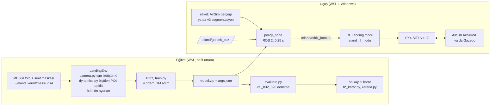

# RL iniş ve AirSim hattı — devir rehberi

> **Kime:** projeye katılan insanlar ve AI ajanları (Claude Code, Codex, Cursor...).
> **Güncel:** 2026-10-20. **Dal:** `airsim` (RL, AirSim ve ön kayıtların hepsi bu dalda).
> **Bu belge:** RL acil iniş ve AirSim çalışmasının tek giriş noktası. Ne var, nasıl kurulur, nasıl
> çalıştırılır, şu an ne koşuyor, hangi kurallar geçerli.
> **Sonuçlar ve yorum:** [`RAPOR.md`](RAPOR.md). **Ön kayıtlar:** [`../onkayit/`](../onkayit/).
> **Genel kurallar:** [`../../AGENTS.md`](../../AGENTS.md). Bu belge onları değiştirmez, RL ve AirSim'e özel
> olanları ekler.

Etiketler: **ölçülen** (koşuldu), **_hesap** (formül), **_tahmin** (varsayım). Kaynak gösterilmeyen sayı
yazılmaz.

---

## 0. 60 saniyede

- **Ne:** Bartolomei ve ark. (IROS 2022) yöntemini kendi iniş kurallarımızla yeniden kurduk.
  - Politika 128×128 bir görüntü görür: sınıf maskesi, derinlik ve güvenli-alan kanalı.
  - Her 0.25 s'de bir üst düzey eylem seçer: dur, 8 yöne kay, alçal. `--diag` ile 8 "kayarken alçal" eylemi
    daha eklenir.
  - PX4 uçurur. Politika yalnız hız komutu verir.
- **Eğitim:** hafif bir numpy/Gymnasium ortamında (`src/eland_rl`), MESSI hava fotoğraflarının sınıf
  maskeleri üstünde, PPO (stable-baselines3) ile.
- **Konuşlandırma:** PX4 SITL'de yeni bir uçuş modu, **RL Landing** (`src/eland_rl_mode`, nav_state 24). Politika
  ROS 2 düğümünde (`policy_node`) koşar.
- **Test dünyaları:** Gazebo (eski hat) ve AirSim (Windows'ta AirSimNH).
- **Durum (ölçülen; doğrulama seti `val_b32`, 320 deneme, 30 s):**

| | Başarı | Süre | Güvensiz | Kaynak |
|---|---|---|---|---|
| **En iyi skor:** c13 s0 (`zemin_v3`, eğitimde 30 s, kayarak alçalma, kalkan eğitimde) | %69.7 | 13.8 s | %7.2 | tarama Tur 3 |
| c13, 3 tohum ortalaması | %66.4 | 15.1 s | %10.4 (kalkansız) | tarama Tur 3 |
| **En yüksek ortalama skor:** c23, 3 tohum (`zemin_v1`, adım −0.5, alçal +1) | %72.5 (kalkanlı) | 16.6 s | %13.9 (kalkansız) | tarama Tur 3; H15'i geçmedi |
| **En yüksek başarı:** B2 s0 + kalkan | %76.9 | 17.4 s | %0.3 | B deneyi |
| Aynı B2 s0 + kalkan, test süresi 90 s | %88.1 | — | — | tanılama |
| Makale (Bartolomei 2022) | %87.6 | 11.8 s | — | farklı sahne ve kural, doğrudan kıyaslanamaz |
| AirSim, çatı üstünden havada başlangıç (c13 s0, AirSim etiketi) | 6/6 | ort. 17.7 s | 0 | gösterim, ölçüm değil |
| AirSim, yoldan tetik, v3 maskesi (B2 s0 + kalkan) | 1/10 | — | 9 yol | Faz 6 |

- **Tarama bitti (H15):** c23 en yüksek ortalama skoru aldı ama ön kayıtlı kuralı geçmedi; B1/B2-s0 yerinde
  kalır.
- **B2 hızlandırma bitti (H19):** hiçbir ince ayar çeşidi süreyi 1.5 s kısaltamadı; B2-s0 aynen kalır.
- **Şu an koşan zincir:** gözlem turu (H16, tabanı c23) → birleşim turu (H18) → AirSim Faz 7. Ayrıntı §7.

---

## 1. Mimari



- **Ortam ile uçuş aynı gözlem kodunu kullanır.** `policy_node`, eğitimin `args.json`'unu okur ve gözlemi
  aynı fonksiyonlarla kurar (`env._observe`, `gozlem.ek_kanallar`).
- **Ortamda bölüm 5 m'de biter.** RL Landing modu da 5 m'nin altında politikayı dinlemez, dikey iner.
- **Kalkan (shield):** 10 m'nin altında, aracın altındaki nokta güvenli değilse "alçal" eylemini engeller
  (`pilots.shield`). Değerlendirmede ayrı bir yöntem (`rl_kalkan`) olarak ölçülür. `--shield-train-m 10` ile
  eğitimin içine de konur.

---

## 2. Depo haritası (RL ve AirSim)

| Yer | Ne |
|---|---|
| `src/eland_rl/eland_rl/` | Python paketi. `env.py` (ortam, ödül ön ayarları `REWARD_PRESETS`), `camera.py` (sanal kamera, ışın–düzlem), `dynamics.py` (PX4 hız döngüsü modeli), `scene.py`/`scenes.py` (sahne yükleme), `policy.py` (kodlayıcılar: `paper`, `paper_onehot`, `iki_kol`, `impala`), `train.py`, `evaluate.py`, `pilots.py` (kalkan, düz iniş), `gozlem.py` (risk/hedef/hafıza kanalları), `policy_node.py` (ROS 2), `vekil.py` (kodlayıcı vekil görevi) |
| `src/eland_rl/test/` | Birim testleri (`bash ~/rl_inis/test_kos.sh`) |
| `src/eland_rl_mode/` | C++ PX4 modu, RL Landing |
| `src/eland_airsim/` | AirSim köprüsü (`kopru.py`), sınıf kuralları (`siniflar.py`), iniş ölçümü (`inis_sina.py`), istasyon tetiği (`rl_tetik.py`), betikler (`scripts/run_airsim.sh`, `inis_sina.sh`, `havada_sec.py`, `px4_sina.sh`), ayarlar (`config/`), ölçüm araçları (`araclar/`) |
| `src/eland_rl/arama/`, `src/eland_rl/gorsel/` | Taramanın ve tez çıktılarının betikleri (ön kayıtların atıf yaptığı kopyalar) |
| `tools/rl_inis/` | `~/rl_inis`'in tam aynası: kuyruklar, karar kuralları, analizler, AirSim pilotları, gösterimler. Dizin: [`../../tools/rl_inis/README.md`](../../tools/rl_inis/README.md) |
| `docs/onkayit/rl_f0_onkayit.md` | RL ön kaydı ve Düzeltme 1–19 (her deney eğitimden önce yazıldı), sonuçlar |
| `docs/onkayit/airsim_faz3..7_onkayit.md` | AirSim fazlarının ön kayıtları ve sonuçları |
| `docs/airsim/README.md` | AirSim hattı: kurulum, Gazebo karşılıkları, hatalar |
| `docs/rl_veri/` | MESSI veri paketinin keşfi ve çözünürlük planı |

---

## 3. Kurulum (yeni makine)

Temel sistem (WSL2 Ubuntu 24.04, ROS 2 Jazzy, PX4 `f63b0d6b6f`, `colcon build`): [`../../src/README.md`](../../src/README.md)
ve [`../DEVIR.md`](../DEVIR.md). Bellek: WSL'e 12 GB verildi. 16 GB'lık makinede Windows'a ~4 GB kalır.

1. **Depo ve dal:**

   ```bash
   cd ~/ros2_ws && git fetch origin && git checkout airsim
   colcon build --packages-select eland_msgs eland_rl eland_rl_mode eland_airsim && source install/setup.bash
   ```

   Dal değiştirince `eland_msgs`'i temiz derle (`rm -rf build/eland_msgs install/eland_msgs`). Yoksa eski bir
   typesupport `.so` kalır, Python düğümleri sessizce ölür.

2. **RL ortamı:**

   ```bash
   rsync -a ~/ros2_ws/tools/rl_inis/ ~/rl_inis/          # betikler ~/rl_inis'te çalışır
   python3 -m venv --system-site-packages ~/rl_inis/venv
   ~/rl_inis/venv/bin/pip install -r ~/rl_inis/requirements_rl_venv.txt
   pip install --user torch==2.13.0 numpy==2.5.1 opencv-python==4.14.0   # sahibinin makinesinde kullanıcı dizininde
   bash ~/rl_inis/test_kos.sh                             # birim testleri
   ```

3. **Veri:** eğitim sahneleri `~/eland_veri/rl/messi_ds4/` (`train_b.txt` 600 sahne, `val_b32.txt` 32,
   `val_b64.txt` 64, `test.txt` final test).
   - Kaynak MESSI veri paketi **özel**. Erişim için Arda'ya sor. Veri ve token depoya girmez.
   - Paketten sahne üretimi: `tools/rl_inis/messi/hazirla.py` (Düzeltme 6). Keşif: `docs/rl_veri/`.
4. **Modeller:** en iyi 4 model depoda, [`../../modeller/`](../../modeller/README.md) altında (c13 s0–s2, B2 s0;
   her biri `model.zip` + `args.json`). `policy_node` gözlemi `args.json`'dan kurar, ikisi aynı klasörde
   durmalı. Öbür modeller sahibinin makinesinde `~/rl_inis/kos/<koşu>/`.
5. **AirSim (Windows):**
   - `C:\Users\<kullanıcı>\airsim\` altına GitHub `microsoft/AirSim` v1.8.1 sürümünün AirSimNH (ve istenirse
     CityEnviron) Windows paketini aç.
   - `run_airsim.sh` ayar dosyasını (`src/eland_airsim/config/settings_px4.json`) kendisi kopyalar.
   - WSL istemcisi: `bash ~/rl_inis/airsim_pilot/venv_kur.sh` (`~/airsim-venv`).
   - **Yollar sahibine göre yazıldı:** `run_airsim.sh`'de `AIRSIM_DIR=/mnt/c/Users/arda_/airsim`. Başka kullanıcıda
     bu satırı değiştir.
   - Ortografik etiket haritası (iniş ölçümü için): `tools/rl_inis/airsim_pilot/orto_kos.sh` ve
     `orto_analiz.py` → `C:\Users\<kullanıcı>\airsim\orto_nh\harita.npz`.

---

## 4. Nasıl çalıştırılır

**Ortak:** `source ~/rl_inis/ortam.sh` (`RL_PY` ve `PYTHONPATH`).

**Eğitim** (taramanın ortak ayarları; c13'ün tam komutu):

```bash
$RL_PY -m eland_rl.train --scenes ~/eland_veri/rl/messi_ds4/train_b.txt --shard --sora-cell 0.25 \
  --steps 1000000 --ent-coef 0.01 --obs sem_depth_sora --vec dummy --seed 0 \
  --reward zemin_v3 --max-t 30 --diag --shield-train-m 10 --out ~/rl_inis/kos/deneme_c13
```

- Kayıt noktası her 100k adımda `ckpt/`. Kesilen koşu `--resume ckpt/model_N_steps.zip` ile sürer
  (öğrenme oranı programı korunur). Yeni klasöre devam eden koşu da `args.json` yazar.
- `--env-json '{"r_step": -0.5}'` ortam ayarını, `--ppo-json '{"gamma": 0.98}'` PPO ayarını değiştirir.
- Bellek: aynı anda en çok 2 eğitim (12 GB WSL). Eğitim koşarken başka GPU/bellek işi başlatma.

**Değerlendirme** (320 deneme; `--diag`/`--shield-train-m`/`--kanallar` modelin eğitimiyle aynı olmalı):

```bash
$RL_PY -m eland_rl.evaluate --scenes ~/eland_veri/rl/messi_ds4/val_b32.txt --model ~/rl_inis/kos/deneme_c13/model.zip \
  --starts 10 --reward zemin_v3 --obs sem_depth_sora --sora-cell 0.25 --diag --shield-train-m 10 --only-rl \
  --out ~/rl_inis/kos/deneme_c13/eval_val_b32_10.csv
python3 -c "import sys; sys.path.insert(0, '$HOME/rl_inis/arama'); from kararla import olc; print(olc(sys.argv[1]))" \
  ~/rl_inis/kos/deneme_c13/eval_val_b32_10.csv
```

**Tarama ve sonraki turlar** (hepsi yeniden başlatılabilir; biten işi atlar, kesileni kayıt noktasından sürdürür):

```bash
$RL_PY -u ~/rl_inis/arama/arama.py        # Tur 1-3, sonunda kararla.py (H15), günlük arama/arama.log
$RL_PY -u ~/rl_inis/arama/b2hiz_tur.py    # "arama bitti"yi bekler (H19)
$RL_PY -u ~/rl_inis/arama/gozlem_tur.py   # "b2hiz bitti"yi bekler (H16)
$RL_PY -u ~/rl_inis/arama/birlesim_tur.py # "gozlem bitti"yi bekler (H18)
bash ~/rl_inis/airsim_pilot/faz7_sonra.sh # "birlesim bitti"yi bekler, sonra Faz 7
bash ~/rl_inis/arama/durum.sh             # kim çalışıyor
```

**AirSim** (Windows'ta en az 1.8 GB boş bellek ister; açık bir sim varsa başlamaz):

```bash
S=~/ros2_ws/src/eland_airsim/scripts
$S/run_airsim.sh --takeoff 25 --trigger                                   # klasik Emergency Landing, AirSim etiketi
$S/run_airsim.sh --takeoff 25 --trigger --v3                              # maske v3 segmentasyondan
$S/run_airsim.sh --havada rastgele:7 --rl ~/rl_inis/kos/arama/t2_c13_f_kayarak_kalkan/model.zip --kalkan 10 --trigger --izle
$S/run_airsim.sh --baslangic -8.9,-0.7 --havada -58.7,-22.1,30 --rl M.zip --kalkan 10 --trigger   # belirli bir havada başlangıç
$S/run_airsim.sh --station --rl M.zip --kalkan 10                         # klavyeyle uç; 0 = RL Landing
$S/inis_sina.sh LISTE.csv [--v3] [--rl M.zip] [--kalkan 10]               # toplu iniş, AirSim gerçeğiyle ölçülür
bash ~/rl_inis/demo/cati/havada_sonra.sh                                  # 6 çatı üstü başlangıç gösterimi
```

- `--havada`: önce 30 m'ye kalkar, hedef noktaya uçar, orada RL'i tetikler. Araç havada doğamaz, PX4 yerde arm
  olur.
- `--izle`: AirSim penceresinde kamera ve segmentasyon alt pencereleri, ayrıca politikanın gördüğü.
- İniş noktası ortografik haritada değerlendirilir: `araclar/inis_harita.py`, `yumusak_say.py`.

**Tez çıktıları:** `$RL_PY ~/rl_inis/gorsel/tez_ciktilari.py` (eğriler, tablolar, Wilson aralıkları) ve
`gorsel/egitim_izleri.py` (makale videosundaki gibi eğitim izleri). Çıktı `C:\Users\arda_\rl_gorsel\`.

---

## 5. Ölçüm ve modeller

**Bir değerlendirme** (`evaluate.py`): `val_b32`'nin 32 sahnesi × sahne başına 10 başlangıç = 320 deneme.
- Başlangıç rastgele, 20–30 m. Tohum `k = 0…9`, her model ve yöntem aynı 320 başlangıçtan uçar.
- Politika argmax seçer. Dinamik nominal, test süresi 30 s.
- **Zemin kuralı (başarı):** indiği noktanın sınıfı çim (0) ya da sert zemin (1), 2 m içinde insan ya da araç
  yok. Yol/ağaç (2), yapı (3), su, araç, insan: güvensiz. 30 s dolarsa süre aşımı.
- **B** başarı %, **T** başarılı inişlerin ortalama süresi, **U** güvensiz %, **TO** süre aşımı %.
- **Skor:** `S = B_kalkan + 0.5·B_RL − 4·max(0, T_kalkan − 12)`. 12 s makalenin süresi.
- 320 denemede Wilson %95 aralığı yaklaşık ±5 puan (_hesap). Kararlar 3 tohumun ortalamasıyla verilir.

**Modeller:**

| Model | Depoda | Sahibinin makinesinde (`~/rl_inis/kos/`) | Ne için |
|---|---|---|---|
| c13 s0 | `modeller/c13_s0/` | `arama/t2_c13_f_kayarak_kalkan` | tek tohumda en iyi skor, AirSim gösterimleri |
| c13 s1, s2 | `modeller/c13_s1/`, `c13_s2/` | `arama/t3_c13_f_kayarak_kalkan_s1`, `_s2` | tohum tekrarı |
| B2 s0 | `modeller/b2_s0/` | `b_B2_s0` | en yüksek kalkanlı başarı; AirSim Faz 3–6'nın varsayılan modeli |
| c23 s0–s2 | — | `arama/t2_c23_b1_adim05_alcal1`, `arama/t3_c23_..._s1`, `_s2` | en yüksek ortalama skor |
| B1 s0–s2 | — | `b_B1_s*` | taramanın kıyası |

Depodaki bir modelle AirSim: `run_airsim.sh --rl ~/ros2_ws/modeller/c13_s0/model.zip --kalkan 10 ...`.

---

## 6. Bu hattın kuralları

AGENTS.md §3'ün hepsi geçerli. Ek olarak:

1. **Ön kayıt.** Her deney eğitimden önce `docs/onkayit/rl_f0_onkayit.md`'ye bir "Düzeltme N" olarak yazılır:
   soru, kollar, tahminler (H…), karar kuralı ve kuralı uygulayan betik (`h*_karar.py`). Sonuç sonra
   "Sonuç: Düzeltme N" bölümüne eklenir. **Kural sonradan değiştirilmez.** Kural kötü çıkarsa yeni bir ön kayıt
   açılır.
2. **Final test** (IrYamim, `test.txt`, Düzeltme 17): **bir kez ve yalnız Arda "koş" deyince.**
   `tools/rl_inis/final_test.sh`. Hiçbir seçim test setine bakarak yapılmaz.
3. **Sormadan dokunma:** segmentasyon (v3, `~/v3_test`), araç hız kestirimi, PX4 parametreleri,
   `kaydedici.py`, `control_station`.
4. **Lisans:** yazarın deposu (v4rl-ucy/multirotors_landing) GPLv3. Yalnız okundu. GPL kodu bu depoya girmez.
5. **İndirme ve kurulum:** yeni paket, veri seti ya da model indirmek onay ister. VIVA-SAFELAND indirmesi
   onaylanmadı.
6. **Gizli bilgi:** token, şifre, anahtar depoya girmez. Veri sahibinin token'ı hiçbir yerde kullanılmaz.
7. **Push:** AGENTS.md §3.7. Biten modül commit + annotated tag + push.

---

## 7. Şu an koşan zincir ve yeniden başlatma

Zincirin her halkası bir öncekinin günlüğünde bir ifade bekler. Hepsi kendi kendine biten işi atlar.

| Sıra | Betik | Bekler | Karar | Ön kayıt |
|---|---|---|---|---|
| 1 | `arama/arama.py` | — | Tur 3 bitince `kararla.py` (H15), sonra "arama bitti" | Düzeltme 15 |
| 2 | `arama/b2hiz_tur.py` | "arama bitti" | `b2hiz_karar.py` (H19) | Düzeltme 19 |
| 3 | `arama/gozlem_tur.py` | "arama bitti" ve "b2hiz bitti" | `gozlem_karar.py` (H16) | Düzeltme 16 |
| 4 | `arama/birlesim_tur.py` | "gozlem bitti" | `birlesim_karar.py` (H18, H18b) | Düzeltme 18 |
| 5 | `airsim_pilot/faz7_sonra.sh` → `faz7_havada.sh` | "birlesim bitti" | Faz 7 ön kaydı | `airsim_faz7_onkayit.md` |
| — | `gorsel/son_islem.sh` | — | saatte bir tez çıktıları | — |

**2026-10-20 18:30 durumu (ölçülen):** tarama 16:45'te bitti (H15: c23 yerini almaz). B2 hızlandırma 18:23'te bitti
(H19: B2-s0 kalır). Gözlem turu "b2hiz bitti"yi görüp başlıyor.

**Yeniden başlatma** (bilgisayar uyuduysa ya da oturum kapandıysa):
1. `uptime` (WSL) ve `tail ~/rl_inis/arama/arama.log` ile bak.
2. Yukarıdaki beş betiği ve `son_islem.sh`'yi yeniden başlat. Kesilen eğitimler son kayıt noktasından sürer.
3. Uzun koşu için bağlı bir `wsl.exe` istemcisi açık kalmalı. Yoksa WSL boşta kapanır ve `/tmp` silinir.

**AirSim'i zincir koşarken açmak:**
- Adı `havada_sonra.sh` olan bir betik çalışırken orkestratör yeni eğitim başlatmaz (`arama.yer_var`).
  Gösterim betikleri bu adı bu yüzden taşır.
- Koşan iki eğitim WSL'de ~7 GB tutar, Windows'a AirSim için yer kalmaz. Eğitimi durdurmak Arda'nın
  kararıdır. Orkestratör ölen eğitimi kuyruğa geri alır ve kayıt noktasından sürdürür.

---

## 8. Tuzaklar (hepsi yaşandı)

**Makine ve WSL**
- **Uyku her şeyi durdurur.** Kapak, güç düğmesi, Başlat → Uyku ve Modern Standby boşta kalma zaman aşımı
  WSL'i dondurur.
  - Sistem-gerekli tutucu (`ES_SYSTEM_REQUIRED`) varken bilgisayar boşta kalma zaman aşımıyla üç kez uyudu.
    Ekran-gerekli tutucu (`ES_DISPLAY_REQUIRED`) eklendikten sonra boşta kalma uykusu görülmedi. Kapak ve güç
    düğmesi yine uyutur.
  - **Claude Code arka plan işleri oturumun çocuğudur.** Oturum kapanınca tutucular ve zincir de ölür
    (2026-10-20 00:31: PC uyudu, zincir 15 saat durdu).
- **`wsl.exe -e bash -c '...'` içinde `$DEĞİŞKEN` ve döngüler bozulur.** Komutları bir betik dosyasına yaz.
- **`pkill -f AD` çağıran kabuğu da öldürür.** PID ile kapat ya da deseni betik dosyasına yaz.
- **Bellek:** eğitimler koşarken başlatılan bir hız ölçümü WSL'i taşırdı (OOM, 2026-10-17). Aynı anda 3
  eğitimde boş bellek 586 MB'a düştü. Aynı anda en çok 2 eğitim.
- **Saat zıplaması** (timesyncd ile Hyper-V): ROS'ta ~5 s duraklamalar. Süre ölçümünde `time.monotonic()`.

**AirSim**
- Windows'ta en az 1.8 GB boş bellek gerekir. Bekçi, 30 s boyunca 500 MB'ın altında kalırsa AirSim'i kapatır.
  AirSim kapandıktan sonra bellek hemen geri dönmez.
- AirSim'in regex'i uzun kalıpta sessizce başarısız olur (`siniflar.CHUNK` = 6 kelime).
- AirSimNH'de çim `Landscape` nesnesi. `Road` karoları kenardaki çimi ve kaldırımı da kapsar. Bu yüzden
  iniş sınıfı ortografik haritadan değerlendirilir.
- PX4 v1.17 `-w` olmadan Gazebo'nun rootfs'unu kullanır, kayıtlı parametreleri ezer. `run_airsim.sh`
  `-w rootfs_airsim` kullanır.
- `policy_node` etiket aboneliği best effort olmalı. RL modu DDS hazır olunca (kalkıştan sonra) başlatılır.
- AirSim bazen uçuşta ölür (~%9). Toplu koşu denemeyi 3 kereye kadar tekrarlar ve sayar.
- Çalışan bir bash betiğini düzenleme. Gövde `{ ...; exit; }` içinde değilse yarı eski, yarı yeni satır okur.

**RL**
- **Eğitimde 30 s sınırı politikayı çökertir.** Hangi bitiş daha ucuzsa o varsayılan olur. D'de yol cezası
  (−40) süre cezasından (−50) ucuz, ajan hep alçaldı. F'de süre ucuz, ajan dolaştı. Kalkan eğitimin içindeyse
  çöküş olmadı (c13).
- **Tohumlar çok farklı çıkar.** c13: %69.7 / %68.8 / %60.6. Tek tohumla karar verilmez.
- **Politika zemini düz sayar.** Derinlik kanalı ev zemininden irtifadır. Çatı üstünde 10 m kalkan çatının
  ~2 m üstünde devreye girer (_hesap, çatı ~8 m).
- **v3 asfaltı "sert zemin" sanıyor** (Faz 1). AirSim'de v3 ile RL 10 inişin 9'unda yola indi (Faz 6).
- Devam eden (`--resume`) koşunun yeni klasörü `args.json` yazmalı; yoksa `policy_node` gözlemi kuramaz.
- Bir eğitimin duvar saati süresi uykuyu da sayar. Hız için `progress.csv`'deki `time/fps`'e bak (~170
  adım/s).

---

## 9. Açık kararlar (Arda'nın)

- Tarama, B2 hızlandırma, gözlem ve birleşim turlarının sonuçları geldikçe hangi modelin AirSim'e gideceği
  (ön kayıtlı kurallar seçer, model değişikliği Arda onaylar).
- AirSim dünyası: AirSimNH ile devam, UE5 (Colosseum ya da Cosys-AirSim), fotogrametri ya da v3 ince ayarı.
- `COM_RC_LOSS_T` (Gazebo rootfs 3.0, `run_sim.sh` 0.5 diyor).
- B deneyinin kural hatası: B0'ın düşük güvensiz oranı süre dolmasından geliyor. `zemin_v1` ve aynalamayı
  yeniden yargılamak yeni ön kayıt ister.
- Yeni fikirler (ön kayıt ister): süre dolmadan yedek iniş, 3 tohumun oylaması, kolaydan zora eğitim, daha çok
  sahne. Gerekçeler [`RAPOR.md`](RAPOR.md) §6'da.
- Final test ("koş").
- `airsim` dalının `main`'e birleştirilmesi.

---

## 10. Yeni bir AI ajanına ilk mesaj (kopyala, yapıştır)

```text
Bu depo bir İHA acil iniş tezi. Önce AGENTS.md'yi, sonra docs/rl_airsim/README.md'yi oku; sonuçlar
docs/rl_airsim/RAPOR.md'de. RL ve AirSim işi `airsim` dalında. Kurallar: plan yaz ve onay bekle; her
deneyi eğitimden önce docs/onkayit/rl_f0_onkayit.md'ye ön kayıt olarak ekle; ölçmediğin sayıyı yazma,
sayıları ölçülen/_hesap/_tahmin diye etiketle; segmentasyona, PX4 parametrelerine dokunma; final test
yalnız Arda "koş" deyince; GPL kodu ve gizli bilgi depoya girmez. Sim başlatmadan önce açık bir sim
var mı bak (pgrep -x px4; Windows'ta AirSimNH.exe). Görevim: <görev>.
```
